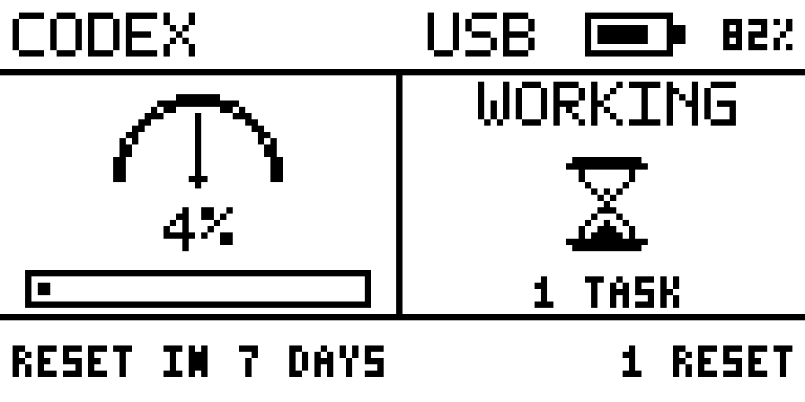

# Flipper Codex Monitor

[](https://github.com/leoliupei/flipper-codex-monitor/actions/workflows/ci.yml)
[](LICENSE)

A local Codex quota and activity monitor for Flipper Zero with Bluetooth Low
Energy as the primary transport and USB as the fallback.

> **Unofficial community project.** This repository is not affiliated with,
> sponsored by, or endorsed by OpenAI or Flipper Devices. OpenAI product names
> and marks remain the property of OpenAI; see
> [Third-party notices](THIRD_PARTY_NOTICES.md).



The project is pre-1.0. Its local Codex integration follows interfaces shipped
with Codex, including App Server messages and Hook metadata, but those
interfaces can change between Codex releases.

The project has two parts:

- `bridge/`: a macOS service that reads the local Codex App Server interface,
  receives privacy-minimized Codex Hook events, and sends compact updates over
  the Flipper USB CLI or the native BLE Serial GATT service.
- `flipper/`: an official-SDK FAP with a 128x64 home screen plus quota, usage,
  task, and link pages. It is also compatible with Momentum builds exposing the
  same FAP API.
- `bridge/macos_ble_helper/`: a signed native CoreBluetooth helper used only
  when USB delivery fails.

Only quota fields, aggregate usage statistics, daily token totals, activity
state, local task numbers, short display labels, token counters, context-window
size, active turn count, and timestamps cross the selected local link. A task
label comes only from the user-facing thread name and is limited to seven
characters. Chinese names are converted to pinyin initials on the Mac; an
unnamed thread displays `NO NAME`. Prompt text, assistant output, working
directories, account identifiers, raw session/turn identifiers, and transcript
paths are not forwarded.

## Requirements and compatibility

- macOS with Bluetooth Low Energy and Xcode Command Line Tools (`xcrun swiftc`)
- Python 3.9 or newer for the bridge, installers, and FAP build
- Python 3.10 or newer only when regenerating the optional design images
- a locally installed Codex executable with App Server and Hook support
- Flipper Zero with a compatible FAP API
- uFBT 0.2.6 for local FAP builds

Version 0.9.18 is built against the official Flipper firmware 1.4.3 SDK, target
7, FAP API 87.1. It has also been tested on Momentum `mntm-012`, which exposes
the same API. FAP compatibility is determined by the API metadata rather than
the firmware brand.

## Quick start

Clone the repository and prepare uFBT:

```sh
git clone https://github.com/leoliupei/flipper-codex-monitor.git
cd flipper-codex-monitor
python3 -m venv .venv
.venv/bin/python -m pip install -r requirements-dev.txt
(cd flipper && ../.venv/bin/ufbt update --channel release)
```

Build and install the FAP while the Flipper is connected over USB:

```sh
(cd flipper && ../.venv/bin/ufbt)
(cd flipper && ../.venv/bin/ufbt launch)
```

The FAP is installed as `/ext/apps/Tools/codex_monitor.fap`.

Preview the macOS service installation, then apply it. Replace `DEVICE` with
the Flipper device name shown by the firmware, without the `Codex ` advertising
prefix:

```sh
python3 scripts/install_service.py \
  --codex-bin "$(command -v codex)" \
  --ble-name DEVICE \
  --dry-run
python3 scripts/install_service.py \
  --codex-bin "$(command -v codex)" \
  --ble-name DEVICE
```

Finally preview and install the two privacy-minimized Codex Hooks:

```sh
python3 scripts/install_hooks.py --dry-run
python3 scripts/install_hooks.py
```

Review and trust the exact commands with `/hooks` in Codex. Installation is
per-user and does not require root access.

The checked-in screen drafts do not need to be regenerated for installation.
Contributors working on those images should use Python 3.10 or newer and
install the isolated design dependency:

```sh
python3 -m pip install -r requirements-design.txt
```

## Transport policy

- BLE is always attempted first and requires a GATT `OK` indication from the
  FAP. The native helper remains available for reconnects while the service is
  running.
- The first BLE discovery is allowed up to 45 seconds. After that initial
  attempt, a missing acknowledgement falls back to USB after 8 seconds while
  the BLE helper keeps reconnecting in the background.
- USB is attempted only after BLE delivery or acknowledgement fails, and it
  also requires a device-side `OK` response.
- Connecting USB never preempts a healthy BLE link. USB remains available for
  launching the FAP, charging, debugging, and temporary recovery when BLE is
  unavailable.
- The bridge still watches USB device presence every 0.5 seconds so a connected
  cable can become the fallback without restarting the service.
- The FAP advertises BLE only while it is open and restores the default
  Bluetooth profile when it exits.
- The monitor profile advertises as `Codex DEVICE`. If the FAP is closed while
  BLE is active, the Mac helper waits for that profile to return and replays
  the last acknowledged state as soon as the FAP is opened again.

## Status model

- `WORKING`: at least one `UserPromptSubmit` turn is active.
- `DONE`: the last active turn completed, failed, or was manually stopped;
  displayed briefly. This global display state does not itself trigger a
  notification.
- `IDLE`: no active turns after the completion hold period.

Quota comes from `account/rateLimits/read`; aggregate and daily usage come from
`account/usage/read`. `account/rateLimits/updated` is used for prompt refreshes
with a one-minute fallback refresh.

The App Server protocol currently exposes live per-thread token usage through
the server-to-client `thread/tokenUsage/updated` notification. It contains
thread and turn IDs, cumulative and latest-call usage, the model context window,
and input, cached-input, cache-write-input, output, and reasoning-output token
breakdowns. Notifications belong to the App Server connection that owns the
thread; the bridge's separate account-data connection does not receive Codex
Desktop's active-thread stream. The bridge therefore uses Hook-provided
`session_id` and `transcript_path` locally, tails only `token_count` records,
and converts them to the same task metrics. Codex documents transcript content
as an unstable Hook interface, so parsing is fail-soft: task state continues to
work and the FAP shows `TOKENS WAITING` if the installed Codex version changes
the local record format. If a Hook omits `transcript_path`, the bridge asks
`thread/read` for the thread's stored path and applies the same allowlist before
opening it.

Codex Hook callbacks themselves contain more data than the monitor needs.
Common callback fields include `session_id`, `transcript_path`, `cwd`, and
`model`; `UserPromptSubmit` also includes `turn_id` and `prompt`, while `Stop`
can include the assistant's final message. The Hook adapter deliberately
allowlists only event type, local session/turn correlation, and transcript path
for bridge-side processing. Raw prompt, reply, model, and working directory are
discarded before the local socket, and only the derived seven-character label
crosses to Flipper.

## Screen

The 128x64 home screen uses a white background and black UI. It shows one
weekly-quota value and progress bar on the left, live Codex activity on the
right, and reset countdown and available reset count along the bottom:

- Header `USB`: USB is carrying monitor updates.
- Header `BLE`: Bluetooth is carrying monitor updates.
- Header `PAIR`: BLE is advertising and waiting for the Mac.
- The header shows `CODEX`, the selected link, and the live Flipper battery
  icon and percentage. It intentionally has no decorative logo.
- The activity panel spells out `WORKING`, `DONE`, `IDLE`, or `OFFLINE` and uses
  concise full-word labels such as `1 TASK`.
- The quota panel uses a 27-by-14-pixel full semicircular pace meter above a compact remaining
  percentage. Its seven stable needle positions run from `0` (quota use is well
  behind elapsed time) through `3` (on pace) to `6` (quota use is well ahead of
  elapsed time). The arc is rasterized from two concentric SDK circles; the
  seven positions do not add protruding tick marks to the circular outline.
  An SDK line and radius-1 disc form the needle and its round pivot.
- `WORKING` uses a classic pixel hourglass: sand falls for about 2.5 seconds,
  then the hourglass flips 180 degrees once and repeats. The label and task
  count move outward to give its 13-by-15-pixel body a 19-pixel flip area.
  Pre-rendered flip frames keep the caps thick and the sand connected.
  `IDLE` shows the installed ChatGPT app's 18-by-18-pixel macOS
  template icon converted directly to 1-bit black and white. It is static and
  does not activate the LED or backlight. `DONE` draws a two-pixel-thick check
  mark over two seconds, then holds the completed mark for the remainder of its
  ten-second display interval. `OFFLINE` shows no busy indicator.
- The bottom row shows `RESET IN N DAYS` when more than 24 hours remain, then
  switches to `RESET IN HH:MM`. Available reset count uses `1 RESET` or the
  appropriate plural form.
- Physically unplugging USB clears a stale `USB` link in about 0.25 seconds;
  the display shows `OFFLINE/PAIR` until BLE delivers the next update.

- `WORKING` plus the full active-task count: one or more local turns are running.
- `DONE`: the last local turn just stopped; held for ten seconds.
- While Codex is working, the RGB LED slowly flows from blue through cyan to
  purple in an approximately ten-second cycle. Brightness changes stay subtle
  and the LED does not go dark mid-cycle. It is off while idle or offline.
- `IDLE`: no local turns are active.

Every individual task completion increments a persisted completion sequence.
The FAP issues one standard success notification for each newly observed
sequence value, even when other tasks are still working. The first payload
after opening the FAP only establishes a baseline, so historical completions
are not replayed. There is no additional notification when the global activity
state changes to `DONE` after the final task finishes.

## Secondary pages and controls

The home screen is the navigation hub:

- Left opens Quota, Down opens Usage, Right opens Tasks, and Up opens Link.
- Holding OK on Home activates the installed ChatGPT macOS app over the active
  BLE link. The action is a fixed allowlisted message; arbitrary commands from
  the Flipper are never executed. A short vibration confirms transmission, and
  the standard error notification indicates that no BLE receiver was available.
- On a secondary page, Left and Right cycle through Quota, Usage, Tasks, and
  Link.
- Back returns to Home. On Home, a short Back press does nothing and holding
  Back exits the app. There is no automatic return timer.

Quota shows the exact remaining percentage, reset countdown, reset date and
time, available reset count, and last quota refresh. All transferred Unix
timestamps stay in UTC; the bridge also sends the Mac's UTC offset, so refresh
times, task start times, elapsed durations, and reset countdowns agree with the
Flipper's local clock.

Tasks is a vertically scrollable list of the 16 most recently active working or
completed local sessions; three rows fit on screen, but the list is not limited
to those three visible rows. Rows sort only by latest activity. Each row shows a
derived short label, full-word state, and local start time. The selected row
uses a solid black background with white text and no arrow. Up and Down scroll,
and OK opens the selected task. Completed entries have no time-based expiry;
the least recently active completed entry leaves only when a seventeenth task
arrives. The sixteen-entry history is restored from the Mac-local mode-`0600`
runtime state after service restarts. Temporary side conversations are shown as
`SIDE`; they cannot be opened from the task list and are removed as soon as
they finish. A `SIDE` entry with no transcript or token activity is discarded
after 30 seconds if its end event never arrives, so it cannot leave the monitor
stuck in `WORKING`. The footer shows `NO DETAILS` while a side conversation is
selected, and detail-page task navigation skips side conversations. A detail
page has two
views: Live shows state, elapsed time, total and latest-call tokens, last-call
context utilization, and update age written with the full `SECOND` or `SECONDS`
unit; Tokens shows cumulative input, cached input, output, and reasoning-output
counts. In detail, Up and Down switch tasks, OK toggles Live and Tokens, Left
and Right do nothing, and Back returns to the Tasks list. Link shows the active
USB or Bluetooth transport, Codex
connectivity, both physical-link states, and how long the active transport has
remained linked.
The selected task is tracked by its stable local task number, so activity-based
list reordering cannot switch an open detail page to another task.

The FAP turns on the display backlight when activity enters `WORKING`. Later
token updates do not retrigger it. Each task completion uses the standard
success notification, which also turns on the display backlight.

The bridge does not depend on `Stop` alone. It also watches the thread record
for `task_complete` and `turn_aborted`, so normal completion, failure, and a
manual stop all exit `WORKING` even when Codex does not invoke the Stop Hook
for an interrupted turn.

Usage has three views. Up and Down cycle between Daily, Weekly, and Total. Daily
starts at 14 days; OK cycles 7, 14, and 30 days. Weekly aggregates the latest
four seven-day blocks. Total shows lifetime tokens, peak day, longest task, and
current and longest streaks. The Daily chart labels its range peak and latest
point in millions, and its endpoint dates are encoded without timezone drift.

## Verification

Run the same checks used by continuous integration:

```sh
PYTHONPATH="$PWD:$PWD/bridge" \
  .venv/bin/python -m unittest discover -s bridge/tests -v
python3 scripts/check_release.py
xcrun swiftc -swift-version 5 -O \
  -framework Foundation -framework CoreBluetooth \
  bridge/macos_ble_helper/main.swift -o /tmp/codex-flipper-ble
(cd flipper && ../.venv/bin/ufbt)
```

## Uninstall

Remove only the two Codex Hooks installed by this project, preserving all other
Hook handlers:

```sh
python3 scripts/uninstall_hooks.py --dry-run
python3 scripts/uninstall_hooks.py
```

Then unload the LaunchAgent and remove the installed application. Private state
and logs are preserved by default:

```sh
python3 scripts/uninstall_service.py --dry-run
python3 scripts/uninstall_service.py
```

Pass `--purge` to `uninstall_service.py` only when the private state and logs
under `~/Library/Application Support/CodexFlipperMonitor` should also be
deleted.

## Installation behavior

The service and Hook installation are intentionally separate. Installing the
service does not change Codex Hooks, and installing Hooks preserves existing
handlers through an additive merge and a mode-`0600` backup.

The first BLE connection may cause macOS to request Bluetooth permission or
show a pairing prompt. While the monitor owns the BLE Serial profile, the
Flipper mobile app cannot use the same BLE connection simultaneously.
The installer preserves an unchanged BLE helper binary so routine bridge-only
updates do not invalidate the macOS Bluetooth permission.

The service installer uses the public LaunchAgent label
`io.github.leoliupei.flipper-codex-monitor`. It recognizes and removes the
legacy `com.liupei.codex-flipper-monitor` LaunchAgent only after the replacement
service starts successfully.

## Privacy, security, and license

The project does not include telemetry or a project-operated cloud service.
See [SECURITY.md](SECURITY.md) for the local trust boundary and vulnerability
reporting process. Source code is available under the [MIT License](LICENSE);
the OpenAI mark used as an `IDLE` status indicator is covered separately by
[THIRD_PARTY_NOTICES.md](THIRD_PARTY_NOTICES.md).
