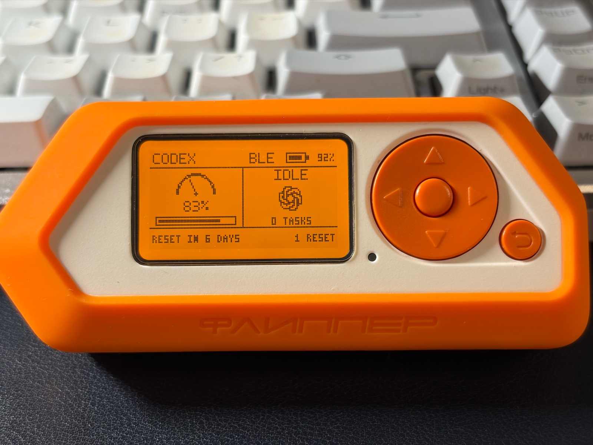

# Flipper Codex Monitor

[English](README.md) | 简体中文

[](https://github.com/leoliupei/flipper-codex-monitor/actions/workflows/ci.yml)
[](LICENSE)

这是一个运行在本地的 Flipper Zero Codex 配额与活动监视器，优先通过低功耗蓝牙（BLE）传输，USB 作为回退链路。

> **非官方社区项目。** 本仓库与 OpenAI 或 Flipper Devices 不存在隶属、赞助或认可关系。OpenAI 产品名称及标识仍归 OpenAI 所有，详见[第三方声明](THIRD_PARTY_NOTICES.md)。



本项目仍处于 1.0 之前的阶段。本地 Codex 集成使用 Codex 当前提供的接口，包括 App Server 消息和 Hook 元数据；这些接口可能随 Codex 版本变化。

项目主要由以下部分组成：

- `bridge/`：macOS 服务，读取本地 Codex App Server 接口，接收经过隐私最小化处理的 Codex Hook 事件，并通过 Flipper USB CLI 或原生 BLE Serial GATT 服务发送紧凑状态更新。
- `flipper/`：使用官方 SDK 构建的 FAP，提供 128×64 首页以及配额、用量、任务和连接页面。它也兼容暴露相同 FAP API 的 Momentum 固件。
- `bridge/macos_ble_helper/`：已签名的原生 CoreBluetooth 辅助程序，仅在 USB 传输失败时使用。

通过所选本地链路传输的数据仅包括：配额字段、聚合用量统计、每日 Token 总量、活动状态、本地任务编号、短显示名称、Token 计数、上下文窗口大小、活跃 Turn 数量和时间戳。任务名称只取自面向用户的任务名称，并限制为七个字符。中文名称会在 Mac 上转换成拼音首字母；尚未命名的任务显示为 `NO NAME`。提示词、助手回复、工作目录、账户标识、原始 Session/Turn 标识以及转录文件路径都不会发送到 Flipper。

## 环境要求与兼容性

- 支持低功耗蓝牙并安装 Xcode Command Line Tools（`xcrun swiftc`）的 macOS
- Bridge、安装器和 FAP 构建需要 Python 3.9 或更高版本
- 仅在重新生成可选设计图片时需要 Python 3.10 或更高版本
- 本机已安装支持 App Server 和 Hook 的 Codex 可执行文件
- Flipper Zero，且 FAP API 兼容
- 本地构建 FAP 使用 uFBT 0.2.6

版本 0.9.19 使用 Flipper 官方固件 1.4.3 SDK、target 7、FAP API 87.1 构建。项目也已在暴露相同 API 的 Momentum `mntm-012` 上完成测试。FAP 兼容性由 API 元数据决定，而不是由固件品牌决定。

当前 beta 已在以下环境中验证；这些是实际测试过的组合，不代表最低版本承诺：

| 路径 | 测试环境 |
| --- | --- |
| 本地端到端 | macOS 26.6.1 arm64、Python 3.9.6、Codex CLI 0.144.1、Apple Swift 6.3.3 |
| 持续集成 | GitHub 托管的 `macos-latest`、Python 3.9 和 3.12 |
| Flipper | 官方固件 1.4.3 SDK / API 87.1；Momentum `mntm-012` |

## 快速开始

克隆仓库并准备 uFBT：

```sh
git clone https://github.com/leoliupei/flipper-codex-monitor.git
cd flipper-codex-monitor
python3 -m venv .venv
.venv/bin/python -m pip install -r requirements-dev.txt
(cd flipper && ../.venv/bin/ufbt update \
  --hw-target f7 \
  --url https://update.flipperzero.one/builds/firmware/1.4.3/flipper-z-f7-sdk-1.4.3.zip)
```

通过 USB 连接 Flipper，然后构建并安装 FAP：

```sh
(cd flipper && ../.venv/bin/ufbt)
(cd flipper && ../.venv/bin/ufbt launch)
```

FAP 会安装到 `/ext/apps/Tools/codex_monitor.fap`。

先预览 macOS 服务安装内容，再正式安装。请把 `DEVICE` 替换为固件显示的 Flipper 设备名，不要包含广播名称中的 `Codex ` 前缀：

```sh
python3 scripts/install_service.py \
  --codex-bin "$(command -v codex)" \
  --ble-name DEVICE \
  --dry-run
python3 scripts/install_service.py \
  --codex-bin "$(command -v codex)" \
  --ble-name DEVICE
```

最后，预览并安装四个经过隐私最小化处理的 Codex Hooks：

```sh
python3 scripts/install_hooks.py --dry-run
python3 scripts/install_hooks.py
```

在 Codex 中通过 `/hooks` 检查并信任这四条具体命令。首次安装或任何 Hook 发生变化后，需要完全退出并重新打开 ChatGPT/Codex，再启动一个新任务，使正在运行的应用重新加载配置。安装仅作用于当前用户，不需要 root 权限。信任模型和支持的事件类型请参阅官方 [Codex Hooks 文档](https://learn.chatgpt.com/docs/hooks)。

安装项目不需要重新生成仓库中已有的屏幕设计图。需要修改这些图片的贡献者应使用 Python 3.10 或更高版本，并单独安装设计依赖：

```sh
python3 -m pip install -r requirements-design.txt
```

## 传输策略

- 始终优先尝试 BLE，并要求 FAP 通过 GATT 返回 `OK` indication。服务运行期间，原生辅助程序会持续保持重连能力。
- 首次 BLE 发现最长允许 45 秒。首次尝试结束后，如果 8 秒内没有收到确认，则回退到 USB，同时 BLE 辅助程序继续在后台重连。
- 仅在 BLE 传输或确认失败后尝试 USB；USB 同样要求设备端返回 `OK`。
- 接入 USB 不会抢占正常工作的 BLE 链路。USB 仍可用于启动 FAP、充电、调试，以及 BLE 不可用时的临时恢复。
- Bridge 每 0.5 秒检查一次 USB 设备是否存在，因此已连接的数据线可以在不重启服务的情况下成为回退链路。
- FAP 只在打开期间广播 BLE；退出时会恢复默认蓝牙 Profile。
- 监视器 Profile 的广播名称为 `Codex DEVICE`。BLE 已连接时如果关闭 FAP，Mac 辅助程序会等待该 Profile 重新出现；再次打开 FAP 后，它会立即重放最后一次已确认的状态。

## 状态模型

- `WORKING`：至少有一个 `UserPromptSubmit` Turn 或 Side 对话正在进行。
- `DONE`：最后一个活跃 Turn 已完成、失败或被手动停止，会短暂显示。这个全局显示状态本身不会触发通知。
- `IDLE`：完成状态保持期结束后，没有活跃 Turn。

配额来自 `account/rateLimits/read`；聚合用量和每日用量来自 `account/usage/read`。提示词触发的刷新使用 `account/rateLimits/updated`，并以一分钟定时刷新作为回退。

App Server 协议目前通过服务端到客户端的 `thread/tokenUsage/updated` 通知暴露每个任务的实时 Token 用量。通知包含 Thread 和 Turn ID、累计和最近一次调用的用量、模型上下文窗口，以及输入、缓存输入、缓存写入输入、输出和推理输出 Token 的明细。通知只属于拥有该 Thread 的 App Server 连接；Bridge 用于读取账户数据的独立连接无法收到 Codex Desktop 活跃任务的数据流。因此，Bridge 在本地使用 Hook 提供的 `session_id` 和 `transcript_path`，只跟踪 `token_count` 记录，并将其转换为相同的任务指标。Codex 将转录文件内容定义为不稳定的 Hook 接口，所以解析采用 fail-soft 策略：即使已安装的 Codex 版本改变了本地记录格式，任务状态仍能继续工作，FAP 会显示 `TOKENS WAITING`。如果 Hook 没有提供 `transcript_path`，Bridge 会通过 `thread/read` 查询该 Thread 的存储路径，并在打开文件前应用同样的允许列表。

Codex Hook 回调本身包含的字段多于监视器实际所需。常见字段包括 `session_id`、`transcript_path`、`cwd` 和 `model`；`UserPromptSubmit` 还包含 `turn_id` 和 `prompt`，`Stop` 则可能包含助手的最终回复。`SubagentStart` 和 `SubagentStop` 还会提供唯一的 `agent_id`；仅靠父 Session ID 无法区分并发的 Side 对话。Hook 适配器有意只允许事件类型、本地任务关联信息、根任务转录路径和 Side 标记进入 Bridge 处理流程。原始提示词、回复、模型、工作目录、Agent 类型和 Side 转录路径会在进入本地 Socket 前被丢弃；发送到 Flipper 的只有派生出的七字符任务名称。

## 屏幕

128×64 首页使用白底黑色界面。左侧显示一个每周配额值和进度条，右侧显示实时 Codex 活动，底部显示重置倒计时和可用重置次数：

- 顶栏 `USB`：USB 正在承载监视器更新。
- 顶栏 `BLE`：蓝牙正在承载监视器更新。
- 顶栏 `PAIR`：BLE 正在广播并等待 Mac 连接。
- 顶栏显示 `CODEX`、当前所选链路，以及 Flipper 实时电池图标和电量百分比；这里有意不放装饰性 Logo。
- 活动区域完整显示 `WORKING`、`DONE`、`IDLE` 或 `OFFLINE`，任务数量使用 `1 TASK` 等简洁的完整单词。
- 配额区域使用一个 27×14 像素的完整半圆节奏仪表，下面显示紧凑的剩余百分比。七个固定指针位置从 `0`（配额使用明显落后于时间进度），经过 `3`（进度匹配），到 `6`（配额使用明显领先于时间进度）。圆弧通过两个同心 SDK 圆栅格化生成，七个位置不会在圆形轮廓外增加突出的刻度。指针由一条 SDK 线和半径为 1 的圆盘组成，形成圆形转轴。
- `WORKING` 使用经典像素沙漏：沙粒下落约 2.5 秒，然后沙漏旋转 180 度并循环。文字和任务数量向两侧移开，为 13×15 像素的沙漏主体留出 19 像素的翻转区域。预渲染翻转帧确保上下盖保持厚度，沙粒保持连贯。`IDLE` 显示从已安装 ChatGPT macOS 应用中直接转换为 1-bit 黑白图的 18×18 模板图标；图标保持静止，不会激活 LED 或背光。`DONE` 在两秒内画出两像素粗的勾形，然后在十秒显示周期的剩余时间里保持完整勾形。`OFFLINE` 不显示忙碌指示器。
- 底部一行在剩余时间超过 24 小时时显示 `RESET IN N DAYS`，之后切换为 `RESET IN HH:MM`。可用重置次数使用 `1 RESET` 或相应的复数形式。
- 实际拔出 USB 后，约 0.25 秒内会清除过期的 `USB` 链路；在 BLE 送达下一次更新前，屏幕显示 `OFFLINE/PAIR`。

- `WORKING` 加完整活跃任务数：一个或多个本地 Turn 正在运行。
- `DONE`：最后一个本地 Turn 刚停止，保持十秒。
- Codex 工作期间，RGB LED 会在约十秒的周期内从蓝色缓慢过渡到青色再到紫色。亮度变化保持轻微，LED 不会在周期中途熄灭；空闲或离线时 LED 关闭。
- `IDLE`：没有活跃的本地 Turn。

每个任务完成时，持久化的完成序号都会加一。FAP 会针对每个新观察到的序号触发一次标准成功通知，即使其他任务仍在运行。打开 FAP 后收到的第一条 Payload 只用于建立基线，不会重放历史完成通知。最后一个任务结束、全局活动状态切换到 `DONE` 时，不会再额外通知一次。

## 二级页面与按键

首页是导航中心：

- 左键打开 Quota，下键打开 Usage，右键打开 Tasks，上键打开 Link。
- 在首页长按 OK，会通过当前 BLE 链路激活已安装的 ChatGPT macOS 应用。该操作使用固定允许列表消息，Flipper 不能执行任意命令。短震动表示发送成功；如果没有可用的 BLE 接收端，则触发标准错误通知。
- 在二级页面中，左键和右键可在 Quota、Usage、Tasks 和 Link 之间循环切换。
- Back 返回首页。在首页短按 Back 不执行操作，长按 Back 退出应用。应用不会自动定时返回。

Quota 页面显示准确的剩余百分比、重置倒计时、重置日期和时间、可用重置次数，以及上次配额刷新时间。传输的 Unix 时间戳统一保持 UTC；Bridge 还会发送 Mac 的 UTC 偏移量，因此刷新时间、任务开始时间、运行时长和重置倒计时都能与 Flipper 本地时钟保持一致。

Tasks 是一个可垂直滚动的列表，保留最近活跃的 16 个运行中或已完成本地 Session；屏幕一次显示三行，但列表并不只限于这三行。条目只按最近活动时间排序。每行显示派生出的短名称、完整状态单词和本地开始时间。选中行使用纯黑背景和白色文字，不显示箭头。任务超过三个时，右侧细滚动条会标出当前三行在完整列表中的位置，底部则显示当前选中行从 1 开始计算的位置。上下键滚动，OK 打开所选任务。已完成条目不会按时间过期；只有第 17 个任务到来时，最久未活跃的已完成条目才会离开列表。服务重启后，会从 Mac 本地权限为 `0600` 的运行状态文件恢复这 16 条历史记录。临时 Side 对话显示为 `SIDE`，不能从任务列表打开，会在完整生命周期内保持可见，并在对应的 `SubagentStop` 到达后立即删除。选中 Side 对话时，底部显示 `NO DETAILS`，详情页的任务切换也会跳过 Side 对话。

任务详情页包含两个视图：Live 显示状态、运行时长、总 Token、最近一次调用 Token、最近一次调用的上下文占用率，以及用完整 `SECOND` 或 `SECONDS` 单位表示的更新时间；Tokens 显示累计输入、缓存输入、输出和推理输出数量。在详情页中，上下键切换任务，OK 在 Live 和 Tokens 之间切换，左右键不执行操作，Back 返回 Tasks 列表。Link 页面显示当前 USB 或蓝牙传输方式、Codex 连接状态、两种物理链路的状态，以及当前传输方式已保持连接的时长。

当前选中任务通过稳定的本地任务编号跟踪，因此按活跃度重新排序列表时，不会把已经打开的详情页切换到其他任务。

活动状态进入 `WORKING` 时，FAP 会打开屏幕背光；之后的 Token 更新不会重复触发背光。每个任务完成时使用标准成功通知，该通知也会打开屏幕背光。

Bridge 不只依赖 `Stop`。它还会监视 Thread 记录中的 `task_complete` 和 `turn_aborted`，因此无论正常完成、失败还是手动停止，即使 Codex 没有为中断的 Turn 调用 Stop Hook，也能退出 `WORKING`。

Usage 页面包含三个视图。上下键在 Daily、Weekly 和 Total 之间循环。Daily 默认显示 14 天；OK 可在 7、14 和 30 天之间切换。Weekly 汇总最近四个七天区间。Total 显示历史累计 Token、峰值日期、最长任务，以及当前和最长连续使用天数。Daily 图表用百万为单位标注区间峰值和最新点，起止日期编码不会产生时区偏移。

## 验证

运行与持续集成相同的检查：

```sh
PYTHONPATH="$PWD:$PWD/bridge" \
  .venv/bin/python -m unittest discover -s bridge/tests -v
python3 scripts/check_release.py
xcrun swiftc -swift-version 5 -O \
  -framework Foundation -framework CoreBluetooth \
  bridge/macos_ble_helper/main.swift -o /tmp/codex-flipper-ble
(cd flipper && ../.venv/bin/ufbt)
```

## 卸载

只删除本项目安装的四个 Codex Hooks，保留其他所有 Hook 处理器：

```sh
python3 scripts/uninstall_hooks.py --dry-run
python3 scripts/uninstall_hooks.py
```

然后卸载 LaunchAgent 并删除已安装的应用。默认保留私有状态和日志：

```sh
python3 scripts/uninstall_service.py --dry-run
python3 scripts/uninstall_service.py
```

只有确实需要同时删除 `~/Library/Application Support/CodexFlipperMonitor` 下的私有状态和日志时，才向 `uninstall_service.py` 传入 `--purge`。

## 安装行为

服务安装与 Hook 安装有意保持独立。安装服务不会修改 Codex Hooks；安装 Hooks 通过增量合并保留已有处理器，并创建权限为 `0600` 的备份。

首次 BLE 连接时，macOS 可能请求蓝牙权限或显示配对提示。当监视器占用 BLE Serial Profile 时，Flipper 手机应用无法同时使用同一个 BLE 连接。安装器会保留内容未变化的 BLE 辅助程序二进制文件，因此日常只更新 Bridge 不会让已有的 macOS 蓝牙权限失效。

服务安装器使用公开的 LaunchAgent 标签 `io.github.leoliupei.flipper-codex-monitor`。只有替代服务成功启动后，它才会识别并移除旧的 `com.liupei.codex-flipper-monitor` LaunchAgent。

## 故障排查

如果新 Codex 任务没有让 Flipper 产生响应，请按以下顺序检查：

1. 保持 FAP 打开；只有 FAP 运行时才会广播监视器 BLE Profile。
2. 打开 `/hooks`，确认四条已安装命令都被信任；然后完全退出并重新打开 ChatGPT/Codex，再启动一个新任务。
3. 使用 `launchctl print gui/$(id -u)/io.github.leoliupei.flipper-codex-monitor` 检查 LaunchAgent。
4. 检查 `~/Library/Application Support/CodexFlipperMonitor/state.json` 中的 `transport` 和 `error`。如果 `transport` 为 null，同时 `error` 中包含 `transport:`，说明 BLE 和 USB 都没有确认最近一次更新。

`NO NAME` 表示 Codex 任务还没有面向用户的名称，并不代表 BLE 失败。不要仅为了移除这个名称而清空整个运行状态。

## 隐私、安全与许可证

本项目不包含遥测，也没有项目方运营的云端服务。本地信任边界和漏洞报告流程请参阅 [SECURITY.md](SECURITY.md)。源代码使用 [MIT License](LICENSE)；作为 `IDLE` 状态指示器使用的 OpenAI 标识另行受[第三方声明](THIRD_PARTY_NOTICES.md)约束。
